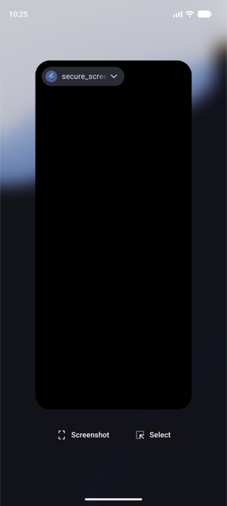

<div align="center">
  <h1 align="center" style="font-size: 50px;">🔒 Secure Screen Privacy 🔒</h1>
  <p align="center">
  Keep sensitive screens private on Android and iOS. Block screenshots and screen recording, hide your app in the App Switcher, and know when the screen is captured.
 </p>
  <p align="center">
  <b>One plugin. Every privacy screen. No permissions to ask for.</b>
 </p>
</div>

<div align="center">
   <!--  Donations -->
  <a href="https://ko-fi.com/mrrhak">
    
  </a>
  <div align="center">
    <a href="https://www.buymeacoffee.com/mrrhak">
      
    </a>
    <a href="https://ko-fi.com/mrrhak">
      
    </a>
  </div>
  <!--  Donations -->
</div>

<div align="center">
  <a href="https://pub.dev/packages/secure_screen_privacy">
    
  </a>
  <a href="https://pub.dev/packages/secure_screen_privacy">
    
  </a>
  <a href="https://pub.dev/packages/secure_screen_privacy/score">
    
  </a>
  <a href="https://pub.dev/packages/secure_screen_privacy">
    
  </a>
  <a href="https://github.com/mrrhak/secure_screen_privacy"></a>
  <a href="https://github.com/mrrhak/secure_screen_privacy"></a>
  <a href="https://github.com/mrrhak/secure_screen_privacy/graphs/contributors">
    
  </a>
  <a href="https://github.com/mrrhak/secure_screen_privacy">
    
  </a>
  <a href="https://opensource.org/licenses/MIT">
    
  </a>
  <a href="https://pub.dev/packages/secure_screen_privacy">
    
  </a>
</div>

<p align="center">
  <a href="#-installation">Install</a> ·
  <a href="#-usage">Usage</a> ·
  <a href="#-features">Features</a> ·
  <a href="#-platform-support">Platforms</a> ·
  <a href="#-notes">Notes</a> ·
  <a href="https://pub.dev/documentation/secure_screen_privacy/latest/">API docs</a> ·
  <a href="https://github.com/mrrhak/secure_screen_privacy/tree/master/example">Example</a>
</p>

---

## ✨ Why secure_screen_privacy?

- **Everything in one place.** Screenshot blocking, App Switcher privacy,
  and screenshot and recording alerts, with one API on Android and iOS.
- **Protect only the screens that need it.** Add one navigator observer and
  list your sensitive routes. It works with `Navigator`, go_router and
  auto_route.
- **No permission prompts.** It never asks for storage, photos or media
  access. The only permissions it uses are granted at install time, and the
  user never sees them.
- **Safe by default.** If something is missing, such as the App Switcher
  image, your screen stays covered instead of showing.

## 🧩 Features

- Block screenshots and screen recording of your app
- Hide your app in the App Switcher with a blur, a solid color, an image, or
  an image over a blur (iOS), or a plain card in your color (Android)
- Turn protection on and off per route, including dialogs, bottom sheets,
  nested navigators, go_router and auto_route
- A stream of screenshot events
- A stream of screen recording and mirroring start and stop events
- Works with iPad multi-window: each window protects itself

## 📦 Installation

```sh
flutter pub add secure_screen_privacy
```

It requires Flutter 3.38 or newer, Android 7.0 (API 24) or newer and iOS 13
or newer.

```dart
import 'package:secure_screen_privacy/secure_screen_privacy.dart';
```

## 🚀 Usage

All calls go through one object:

```dart
final privacy = SecureScreenPrivacy();
```

### Block screenshots and screen recording

```dart
await privacy.enableCaptureProtection();
await privacy.disableCaptureProtection();

final isOn = await privacy.isCaptureProtectionEnabled();
```

Screenshots and recordings of your app come out blank while it's on.

### Hide the app in the App Switcher

```dart
// A blur of the current screen.
await privacy.enableAppSwitcherProtection(
  AppSwitcherProtectionMode.blur,
  blurIntensity: BlurIntensity.medium,
);

// A solid color (ARGB).
await privacy.enableAppSwitcherProtection(
  AppSwitcherProtectionMode.color,
  color: 0xFF1E3A8A,
);

await privacy.disableAppSwitcherProtection();
final isOn = await privacy.isAppSwitcherProtectionEnabled();
```

| Mode | iOS shows | Android shows |
| --- | --- | --- |
| `blur` | a blur of the screen | a card in your theme's background color |
| `color` | `color` | a card in `color` |
| `image` | your image on `imageBackgroundColor` | a card in `imageBackgroundColor` |
| `imageBlur` | your image over a blur | a card in your theme's background color |

`blurIntensity` is `ultraLight` (default), `light`, `medium` or `heavy`.

**Image modes:** add an image set named `SecureScreenPrivacyImage` to your
iOS app's `Assets.xcassets`. It's shown at its own aspect ratio, never
cropped, with `imageBackgroundColor` filling the rest. Android needs no
image.



### Protect only some screens

Add `SecureScreenPrivacyNavigatorObserver` and give each sensitive route a
`SecureRouteConfig`. Routes that aren't listed use `defaultConfig`, which is
everything off.

```dart
MaterialApp(
  navigatorObservers: [
    SecureScreenPrivacyNavigatorObserver(
      policies: {
        // Block screenshots only.
        '/payment': const SecureRouteConfig(captureProtection: true),
        // Hide in the App Switcher only.
        '/profile': const SecureRouteConfig(
          appSwitcherMode: AppSwitcherProtectionMode.blur,
        ),
        // Both.
        '/wallet': const SecureRouteConfig(
          captureProtection: true,
          appSwitcherMode: AppSwitcherProtectionMode.color,
        ),
      },
    ),
  ],
)
```

**Dialogs and bottom sheets** don't change protection unless you name them
and list the name:

```dart
showDialog(
  context: context,
  routeSettings: const RouteSettings(name: '/pin-dialog'),
  builder: (_) => const PinDialog(),
);
```

When it closes, the screen under it gets its own protection back.

**go_router:**

```dart
GoRouter(
  observers: [SecureScreenPrivacyNavigatorObserver(policies: policies)],
  routes: [...],
)
```

A page's name is the `GoRoute`'s `name`, or its `path` when it has none.

**auto_route:**

```dart
MaterialApp.router(
  routerConfig: router.config(
    navigatorObservers: () => [
      SecureScreenPrivacyNavigatorObserver(policies: policies),
    ],
  ),
)
```

A page's name is the route's name, such as `PaymentRoute`.

### Detect screenshots

```dart
final subscription = privacy.screenshotEvents.listen((event) {
  print('Screenshot at ${event.timestamp}');
});

// Stop listening:
await subscription.cancel();
```

Listening starts detection and cancelling stops it. An event carries only
the time, never the image.

### Detect screen recording

```dart
final subscription = privacy.screenRecordingEvents.listen((event) {
  switch (event.state) {
    case ScreenRecordingState.recording:
      print('Recording started');
    case ScreenRecordingState.notRecording:
      print('Recording stopped');
    case ScreenRecordingState.unknown:
      print("This device can't detect recording");
  }
});
```

You get the current state as soon as you listen, then each change.

## 📱 Platform support

| Feature | Android | iOS |
| --- | --- | --- |
| Block screenshots | ✅ | ✅ |
| Block screen recording | ✅ | ✅ |
| App Switcher: hide content | ✅ | ✅ |
| App Switcher: `blur` | ❌ plain card | ✅ |
| App Switcher: `blurIntensity` | ❌ | ✅ |
| App Switcher: `color` | ✅ Android 13+ (card color) | ✅ |
| App Switcher: `image` | ❌ card in `imageBackgroundColor` | ✅ |
| App Switcher: `imageBlur` | ❌ plain card | ✅ |
| Card follows dark/light mode | ✅ Android 13+ | — |
| Per-route protection | ✅ | ✅ |
| Dialog and bottom sheet protection | ✅ | ✅ |
| go_router and auto_route | ✅ | ✅ |
| Screenshot events | ✅ | ✅ |
| Screenshot events of your app only | ✅ Android 14+ | ✅ |
| Screen recording start and stop events | ✅ Android 15+ | ✅ |
| Multi-window (each window protected on its own) | — | ✅ iPad |
| Minimum version | Android 7.0 (API 24) | iOS 13 |

✅ supported · ❌ not supported · — not applicable

## 📝 Notes

<details>
<summary>Behavior details and tips (click to expand)</summary>

**Blocking screenshots**

- With only screenshot blocking on, the App Switcher shows a blank card for
  your app. That's the operating system hiding the window, not a bug. Turn
  on App Switcher protection to choose what shows there instead.
- iPad multi-window: each window runs its own Flutter engine, so protection
  applies to the window whose code turned it on. Turn it on in each window
  that needs it.

**App Switcher on iOS**

- The cover shows when the app stops being active. That also happens for a
  phone call, Siri, Control Center or a share sheet, so the cover flashes
  briefly then too.
- While the cover shows, screenshot blocking is paused, so the cover itself
  can appear in the App Switcher. It comes back on as soon as the app is
  active again.
- Without the `SecureScreenPrivacyImage` asset, `image` shows just
  `imageBackgroundColor` and `imageBlur` just the blur, and a warning is
  logged in Xcode.

**App Switcher on Android**

- Android can't draw a blur or an image in the App Switcher. Protection uses
  `FLAG_SECURE`, which hides your content and shows a plain card.
- On Android 13 and newer the card's color follows the table above, and
  changes right away when the device switches between dark and light mode.
  On Android 12 and older it uses your theme's background color from when
  the app started.
- The card color is set with `setTaskDescription`. The label and colors
  Flutter sets there are kept, but a custom task icon isn't while protection
  is on.
- Opening the App Switcher straight from the app, or the "swipe up and hold"
  gesture, still shows the live screen for that moment. Android draws the
  real window there, and no app can stop it. Once the app is in the
  background, its card is blank.

**Per-route protection**

- `showDialog` and `showModalBottomSheet` use the root `Navigator`, so put the
  observer on that one (as in `MaterialApp` above).
- Nested navigators (tabs, shell routes): give each `Navigator` its own
  observer. Protection is on when any showing navigator wants it, and the App
  Switcher mode comes from the innermost one that sets a mode. Tabs kept alive
  side by side all count, so a protected route on a hidden tab keeps
  protection on until that tab navigates.
- Pages added below the one showing (a deep link that opens several pages,
  auto_route's `insert`) don't change protection until they're on top.

**Screenshot events**

- Android 14 and newer: the system reports each screenshot of your app once,
  only while your app is on screen. This uses the `DETECT_SCREEN_CAPTURE`
  permission, which is granted at install time, is never shown to the user,
  and is added to your app for you.
- Android 13 and older: there's no screenshot signal, so the plugin watches
  for new images whose name contains "screenshot". Images from other apps
  can sometimes be reported, and screenshots with a translated file name
  (like "Bildschirmfoto") can be missed.
- On Android a screenshot attempt is reported even while blocking is on.
  The saved image is black, but you can still react to the attempt.
- iOS: only screenshots taken while your app is on screen are reported,
  also when it's visible but not in front (behind Control Center, or in
  iPad Split View).
- On Android 13 and older, screenshots are reported while your app runs in
  the background too. Check that your app is in the foreground if you need
  to.

**Screen recording events**

- Android 15 and newer report recording start and stop. This uses the
  `DETECT_SCREEN_RECORDING` permission, granted at install time and added
  for you.
- Android 14 and older can't detect recording: the stream sends one
  `unknown` event and nothing after. `event.isRecording` is false for both
  `notRecording` and `unknown`, so check `event.state` to tell them apart.
- On iOS, mirroring the screen (AirPlay) counts as recording.

</details>

## 🐞 Bugs or Requests

If you encounter any problems, feel free to open an [issue](https://github.com/mrrhak/secure_screen_privacy/issues/new). If you feel the library is missing a feature, please raise a [ticket](https://github.com/mrrhak/secure_screen_privacy/issues/new) on GitHub and I'll look into it. Pull requests are also welcome.

## 💖 Support

Don't forget to give it a like 👍 or a star ⭐

## 📄 License

MIT. See [LICENSE](LICENSE).
